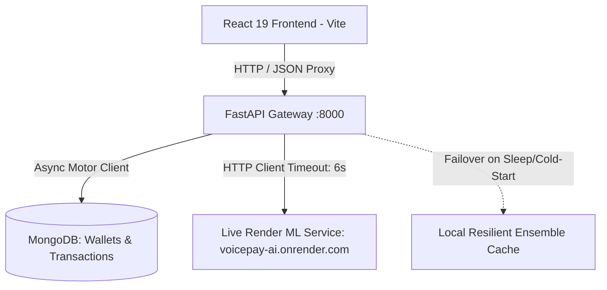

# VoxPay AI — Backend Architecture & ML Integration

Production-grade FastAPI backend service for **VoxPay AI** (Shenzhen International FinTech Competition / FinTechathon 2026).

---

## 🌟 Architecture Overview



- **Framework**: FastAPI (Python 3.10+) with Uvicorn async ASGI server.
- **Database**: MongoDB with async [Motor](https://motor.readthedocs.io/) driver + automated in-memory fallback.
- **Validation**: Pydantic v2 schemas for strict request/response data contracts.
- **External ML Gateway**: Deployed ensemble model on Render (`https://voicepay-ai.onrender.com`).
- **Interactive API Docs**: Auto-generated Swagger UI at `http://localhost:8000/docs`.

---

## 🤖 Machine Learning Model Integration

### 1. Model Service Metadata
- **Service Name**: VoicePay AI Credit Risk & Fraud Prediction Service
- **Model Version**: `vhre-v3-research-1.0.3`
- **Calibration**: Platt Calibrated (`platt_calibrated`)
- **API Base URL**: `https://voicepay-ai.onrender.com`
- **API Docs (Swagger)**: `https://voicepay-ai.onrender.com/docs`
- **Health Check Endpoint**: `GET https://voicepay-ai.onrender.com/health`
- **Prediction Endpoint**: `POST https://voicepay-ai.onrender.com/predict`

### 2. Input Specification (19 Numeric Fields)
The model expects exactly 19 numeric fields representing historical repayment status, bill amounts, and previous payments across the preceding 6 months:

| Category | Input Fields | Description / Format |
| :--- | :--- | :--- |
| **Credit Limit** | `credit_limit` | Assigned credit limit in BDT / equivalent currency (e.g., `20000`) |
| **Repayment Status** | `pay_sep`, `pay_aug`, `pay_jul`, `pay_jun`, `pay_may`, `pay_apr` | Repayment status: `-1` = paid duly, `0` = revolving balance, `1` = payment delay 1 month, `2` = delay 2 months, etc. |
| **Bill Amounts** | `bill_sep`, `bill_aug`, `bill_jul`, `bill_jun`, `bill_may`, `bill_apr` | Billed amount in currency for each of the 6 months |
| **Previous Payments**| `payment_sep`, `payment_aug`, `payment_jul`, `payment_jun`, `payment_may`, `payment_apr` | Amount paid in currency for each of the 6 months |

#### Sample Request Payload:
```json
{
  "credit_limit": 20000,
  "pay_sep": 2,
  "pay_aug": 2,
  "pay_jul": -1,
  "pay_jun": 1,
  "pay_may": -1,
  "pay_apr": 2,
  "bill_sep": 3913,
  "bill_aug": 3102,
  "bill_jul": 689,
  "bill_jun": 0,
  "bill_may": 0,
  "bill_apr": 0,
  "payment_sep": 0,
  "payment_aug": 689,
  "payment_jul": 0,
  "payment_jun": 0,
  "payment_may": 0,
  "payment_apr": 0
}
```

### 3. Output Specification
```json
{
  "prediction": 1,
  "prediction_label": "high_risk",
  "default_probability": 0.744736,
  "probability_type": "platt_calibrated",
  "threshold": 0.276105,
  "model_version": "vhre-v3-research-1.0.3",
  "disclaimer": "Research model trained on UCI Taiwan credit-card default dataset..."
}
```
- `prediction`: `0` = Low Risk (Approved), `1` = High Risk (Default / Fraud).
- `prediction_label`: Human-readable classification string (`"low_risk"` or `"high_risk"`).
- `default_probability`: Platt-calibrated estimated probability of loan default (0.00 to 1.00).
- `threshold`: Optimal decision boundary threshold (`0.276105`).

---

## ⚖️ Subgroup Fairness Audit & Research Notes

A subgroup fairness audit was conducted on the held-out, group-aware test set using **sex** and **age** categories. Demographic attributes were explicitly excluded from predictive input features and retained strictly for post-hoc auditing.

### 1. Male vs. Female Subgroup Evaluation
- **Positive Prediction Rate Difference**: `+2.66 percentage points` (95% bootstrap confidence interval: `0.52 to 4.87 pp`). Because the interval does not include zero, evidence exists of a slight difference in positive prediction rates in this evaluation sample.
- **Error Rates & Calibration**: Confidence intervals for the differences in True Positive Rate (TPR), False Positive Rate (FPR), precision, and Brier score all **included zero**, confirming strong demographic parity across key performance metrics.

### 2. Under-35 vs. 35-and-Older Subgroup Evaluation
- **Multi-Metric Parity**: All five examined metric differences (TPR, FPR, accuracy, calibration, Brier score) had 95% bootstrap confidence intervals that included zero.
- **Observed Precision Difference**: `−4.14 percentage points` (95% CI: `−9.40 to 1.13 pp`), leaving uncertainty about the direction and magnitude of the underlying difference.

> **Research Caution:** These findings are exploratory rather than a definitive determination of fairness. Multiple metrics were examined without adjustment for multiple comparisons, and training utilized a Taiwanese benchmark credit dataset. Real-world commercial micro-lending deployment in Bangladesh requires training on representative Mobile Financial Services (MFS) alternative data with continuous bias monitoring.

---

## 🛠️ API Endpoints Summary

### 1. Machine Learning & Loans (`/api/ml`)
- `POST /api/ml/predict-loan-risk` & `POST /api/ml/predict`:
  - Accepts the 19 numeric input fields or demo preset profiles (`profile_trusted_farmer`, `profile_fraud_ring`, `profile_gig_worker`).
  - Calls `https://voicepay-ai.onrender.com/predict` with a 6-second timeout.
  - Automatically maps default probabilities to calibrated credit scores (300 to 900) and approved loan limits.
- `POST /api/ml/apply-loan`:
  - Approves and disburses instant micro-loans (৳5,000 – ৳25,000) into user wallet.
  - Records an active EMI schedule and appends to the transaction audit ledger.

### 2. Wallet & Balances (`/api/wallet`)
- `GET /api/wallet`: Returns current balance (BDT, e-CNY, Green tokens), active loan status, and KYC verification tier.
- `PUT /api/wallet/balance`: Direct atomic balance adjustment.
- `POST /api/wallet/reset`: 1-click state reset for repeated demo pitches.

### 3. Transactions (`/api/transactions`)
- `GET /api/transactions`: Fetches recent transactions sorted newest first.
- `POST /api/transactions`: Creates an atomic transaction record (Send money, utility, e-CNY remittance, etc.) and synchronizes wallet balances.

### 4. Satellite Weather Oracle (`/api/weather`)
- `POST /api/weather/trigger-disaster`: Simulates Cyclone 'Remal' or flash flood alerts; automatically freezes loan installments with 0% penalty and disburses ৳8,500 emergency crop insurance.
- `POST /api/weather/reset`: Restores normal repayment conditions.

---

## 🚀 Getting Started

### 1. Activate Environment & Install Dependencies
```powershell
cd c:\Users\alsha\Desktop\VoxPay\backend
.\.venv\Scripts\activate
# Dependencies are listed in requirements.txt
pip install -r requirements.txt
```

### 2. Run Self-Check Test Suite
```powershell
python test_self_check.py
```
*Executes assertions testing Pydantic models, live Render ML prediction, and in-memory database operations.*

### 3. Start the Server
```powershell
python main.py
```
Or directly with Uvicorn:
```powershell
uvicorn main:app --reload --port 8000
```
- API Base: `http://localhost:8000`
- Swagger Interactive Docs: `http://localhost:8000/docs`
